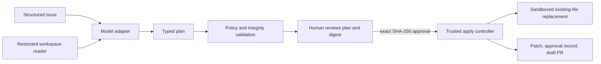

# Architecture

## Design goal

Keep the uncertain component narrow. A model adapter can propose a typed plan,
but only the controller can read through the workspace policy or write a file.
The controller does not expose a general command runner.



## Components

### Domain schema

`domain.py` defines the issue fixture, evidence citations, change proposals,
versioned plan, and plan envelope. Parsers reject unknown and missing fields.
The SHA-256 digest covers canonical JSON for the entire plan.

### Workspace policy

`policy.py` validates model-controlled paths and payload sizes. The default
editable roots are `src`, `tests`, and `docs`. Hidden paths, traversal, absolute
paths, Windows-style separators, unapproved extensions, duplicate file changes,
and unbounded replacements are rejected.

### Filesystem sandbox

`workspace.py` resolves a canonical root, walks each path component with
`lstat`, rejects symlinks and non-regular files, caps file reads, requires UTF-8,
and uses hash preconditions. Existing files are replaced atomically within their
parent directory. The code attempts a best-effort rollback if a later write in
an approved batch fails.

### Evidence collector

`scanner.py` requires exactly one occurrence of the proposed source text. It
records the repository-relative path, line range, snippet, and full file digest.

### Model adapter

`model.py` contains a protocol and a deterministic mock implementation. The
mock reads explicit hints from the synthetic issue so tests can prove controller
behavior without nondeterminism, network calls, or credentials. It is not
presented as an AI system.

### Controller

`engine.py` owns the two-phase flow:

1. `create_plan` validates inputs, collects evidence, validates model output,
   and writes a digest-bearing plan outside the workspace.
2. `apply_plan` requires the exact digest, revalidates the plan, preflights all
   current files, applies approved replacements, and emits local artifacts.

### Presentation

`draft.py` generates a unified diff and a draft PR body. Test commands are text
recommendations only. `cli.py` exposes the controller without a bypass flag or
automatic approval mode.

## State transitions

```text
synthetic issue + workspace
        |
        v
   PLAN WRITTEN -------- integrity or policy failure ------> STOP
        |
        v
 human reviews exact plan and digest
        |
        +--------------- missing/wrong approval ----------> STOP
        |
        v
  full preflight -------- stale/ambiguous workspace -------> STOP
        |
        v
 constrained writes ----- write failure -> rollback -------> STOP
        |
        v
 local patch + approval record + draft PR
```

There is no transition from this repository to a remote pull request. That
would be a separate service and trust boundary.
